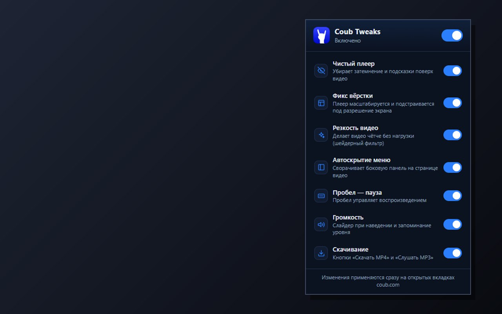
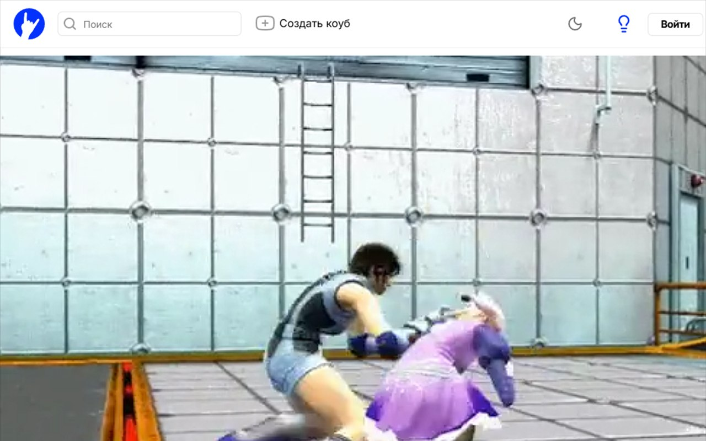
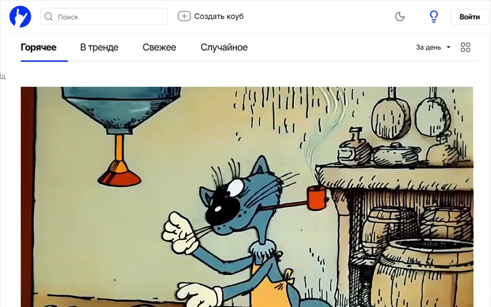

# Coub Tweaks

Неофициальное расширение для Chrome, которое делает просмотр [coub.com](https://coub.com) удобнее: чистит плеер, наводит порядок в вёрстке, включает настоящее HD-качество в ленте, добавляет резкость, показывает аватар аккаунта в шапке и кнопки скачивания.

## Возможности

Каждую функцию можно включать и выключать отдельно в попапе расширения.

| Функция | Что делает |
|---|---|
| **Чистый плеер** | Убирает затемнение, подсказки и тёмные оверлеи поверх видео |
| **Фикс вёрстки** | Плеер масштабируется и подстраивается под разрешение экрана; на 2K/4K растягивается только колонка видео, а интерфейс остаётся обычного размера; строка табов — на всю ширину контента |
| **Резкость видео** | Шейдерный SVG-фильтр: делает видео чётче, нагрузки на систему практически нет |
| **Аватар аккаунта** | В шапке показывает настоящий аватар канала вместо стандартной заглушки |
| **Автоскрытие меню** | Сворачивает боковую панель на странице видео и разворачивает на остальных |
| **Пробел — пауза** | Пробел управляет воспроизведением (кроме полей ввода) |
| **Громкость** | Компактный регулятор в углу плеера: при наведении раскрывается ползунок, колесо мыши меняет уровень, клик по динамику — мьют. Уровень запоминается |
| **Скачивание** | Кнопки «Скачать MP4» и «Слушать MP3» под описанием видео |

Плюс общий переключатель в шапке попапа — выключает всё сразу.

Отдельно: в ленте расширение подменяет низкое качество (`coub-low.mp4`) на HD-версию (`coub-hd.mp4`), поэтому видео в ленте становится чётким.

## Скриншоты

## Установка

### Chrome Web Store
Ссылка появится здесь после публикации.

### Вручную (Load unpacked)
1. Скачайте `coub-tweaks-1.1.9.zip` со страницы [Releases](../../releases) и распакуйте в любую папку.
2. Откройте `chrome://extensions/` и включите **Режим разработчика** (справа вверху).
3. Нажмите **Загрузить распакованное расширение** и выберите папку, в которой лежит `manifest.json`.
4. Закрепите иконку на панели Chrome (значок пазла → булавка) и обновите вкладку coub.com.

### Из исходников
Скачайте ZIP репозитория (кнопка **Code → Download ZIP**) или склонируйте его, затем повторите шаги 2–4: папка с `manifest.json` и есть расширение.

## Как это устроено

Manifest V3, минимум разрешений:

| Файл | Назначение |
|---|---|
| `content.js` | CSS и элементы интерфейса (изолированный мир) |
| `page-script.js` | Работа внутри страницы: пробел, громкость (MAIN world) |
| `background.js` | Служебный: сброс зума, оставшегося от старых версий |
| `popup.html` / `popup.css` / `popup.js` | Попап с переключателями |

Разрешения:
- `storage` — хранение настроек (`chrome.storage.sync`);
- `*://*.coub.com/*` — работа только на coub.com.

Настройки применяются сразу на открытых вкладках — перезагружать страницу не нужно.

## Приватность

Расширение не собирает и не передаёт никакие данные. Подробности — [PRIVACY.md](PRIVACY.md).

## Отказ от ответственности

Это неофициальное расширение. Оно не связано с Coub и не поддерживается ими. «Coub» — торговая марка соответствующего правообладателя.

## Лицензия

[MIT](LICENSE)

---

# Coub Tweaks (English)

Unofficial Chrome extension that makes browsing [coub.com](https://coub.com) nicer: clean player, layout fix for any screen resolution, real HD video in the feed, a sharpening filter, the real account avatar in the header, a volume slider and MP4/MP3 download buttons.

Every feature can be toggled separately in the popup. The extension collects no data and runs only on coub.com.

**Install:** download `coub-tweaks-1.1.9.zip` from [Releases](../../releases), unzip it, open `chrome://extensions/`, enable **Developer mode**, click **Load unpacked** and choose the folder containing `manifest.json`.

Licensed under the [MIT License](LICENSE).
